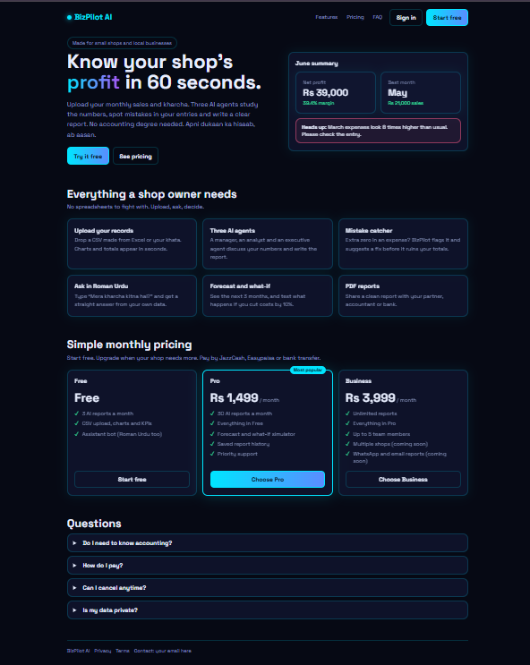
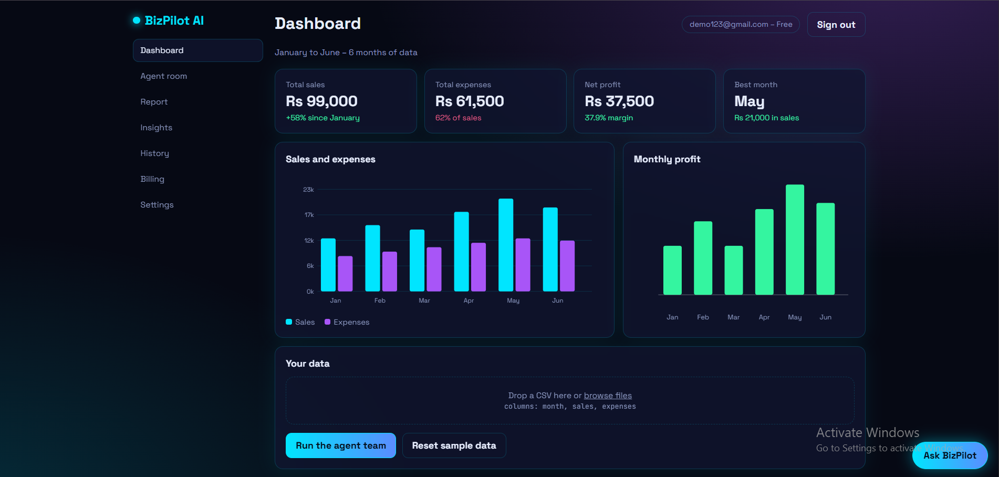
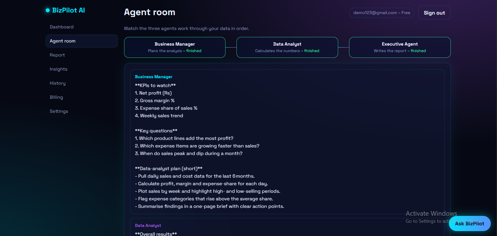
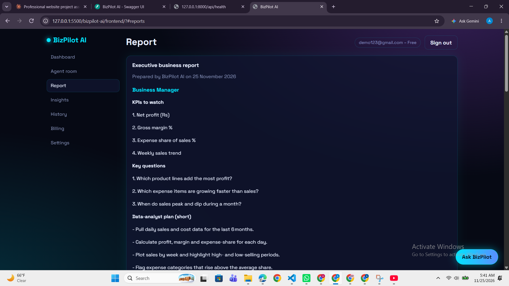
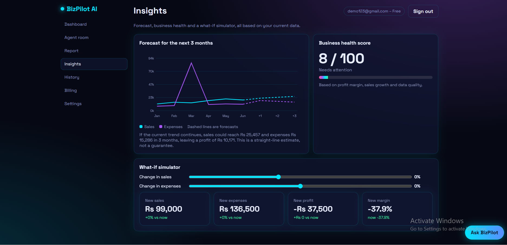
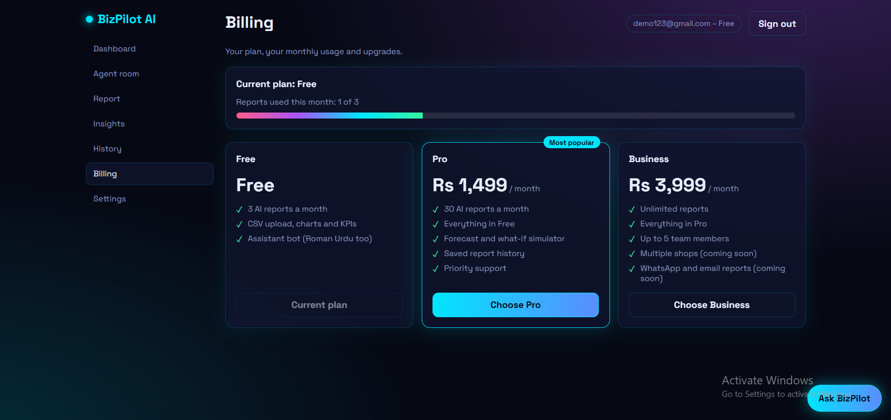
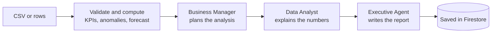
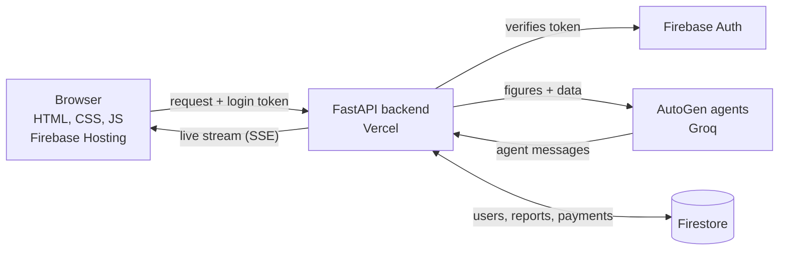

<div align="center">

# 🚀 BizPilot AI

### Know your shop's profit in 60 seconds.

**Three AI agents turn a small shop's monthly sales and expenses into a clear, plain-language profit report.**

<p>
  
  
  
  
  
  
</p>
<p>
  
  
  
  
  
</p>

[**Live Demo**](https://bizpilot-ai-794a0.web.app) &nbsp;•&nbsp; [**API Docs**](https://bizpilot-ai-rho.vercel.app/docs) &nbsp;•&nbsp; [**Presentation**](docs/BizPilot_AI_Presentation.pptx) &nbsp;•&nbsp; [**Report Issues**](../../issues)

</div>

---

## 📑 Table of Contents

- [Overview](#-overview)
- [Screenshots](#-screenshots)
- [Key Features](#-key-features)
- [How It Works](#-how-it-works)
- [Architecture](#-architecture)
- [Tech Stack](#-tech-stack)
- [Project Structure](#-project-structure)
- [Getting Started](#-getting-started)
- [Environment Variables](#-environment-variables)
- [API Reference](#-api-reference)
- [Plans and Payments](#-plans-and-payments)
- [Security](#-security)
- [Testing](#-testing)
- [Deployment](#-deployment)
- [Improvements Over the Class Code](#-improvements-over-the-class-code)
- [Limitations](#-limitations)
- [Roadmap](#-roadmap)
- [Author](#-author)

---

## 🌟 Overview

Small shop owners often keep their sales and expenses in a notebook or a chat group, so they rarely know their real monthly profit. One extra zero in an expense can turn a profit into a loss on paper, and an accountant is expensive.

**BizPilot AI** fixes this. The owner uploads a simple table (`month`, `sales`, `expenses`). Reliable Python code calculates the exact figures and flags suspicious entries. Then a team of three AutoGen agents discusses the numbers in order and writes an executive report in plain language.

> The language model **explains** the numbers; it never does the arithmetic. Every total, margin and forecast is calculated by code and passed to the agents as verified figures.

This project started as a classroom **AutoGen multi-agent assignment** at SMIT and was extended into a full product with a landing page, login, dashboard, subscription plans and a local payment flow (JazzCash, Easypaisa and bank transfer).

---

## 📸 Screenshots

> Add your screenshots to `docs/screenshots/` using the file names below and they will appear here.

| Landing page | Dashboard |
|:---:|:---:|
|  |  |

| Agent room | Report |
|:---:|:---:|
|  |  |

| Insights (forecast) | Billing |
|:---:|:---:|
|  |  |

---

## ✨ Key Features

| | Feature | Description |
|---|---|---|
| 📤 | **CSV upload** | Drop a CSV from Excel or your khata and get totals and charts instantly. |
| 🤖 | **Three-agent analysis** | Business Manager, Data Analyst and Executive Agent discuss your numbers in order. |
| 📡 | **Live agent room** | Agent messages stream to the browser as they are written (Server-Sent Events). |
| 📊 | **KPI dashboard** | Total sales, expenses, net profit, margin and best month, with sales and profit charts. |
| 🛡️ | **Mistake catcher** | An expense above 3 times the median is flagged, with a suggested fix. |
| 🔮 | **Forecast and what-if** | A 3-month trend forecast and sliders to test cost cuts or sales growth. |
| 💬 | **Assistant bot** | Ask questions in **English or Roman Urdu**, answered from your own data. |
| 📄 | **Executive report** | A clear report you can save as PDF, with history of past reports. |
| 💳 | **Subscription plans** | Free, Pro and Business with monthly limits enforced on the server. |
| 🔐 | **Login and admin** | Firebase email/password login and an admin page to approve payments. |

---

## 🧠 How It Works



| Agent | Role |
|---|---|
| **Business_Manager** | Names the KPIs that matter and gives the analyst a short plan. |
| **Data_Analyst** | Reports totals, monthly profit, best month, trends and data warnings using the verified figures. |
| **Executive_Agent** | Writes the final report: performance, opportunities, risks, ways to raise profit and cut expenses, decisions. |

The agents run in an AutoGen `RoundRobinGroupChat` powered by the Groq model `openai/gpt-oss-120b`.

---

## 🏗️ Architecture



The browser never talks to Groq or Firestore directly. Only the backend does, after checking the user's Firebase token.

---

## 🛠️ Tech Stack

| Layer | Technology |
|---|---|
| **Frontend** | HTML, CSS and vanilla JavaScript (no build step) |
| **Backend** | Python, FastAPI, Pydantic |
| **Agents** | Microsoft AutoGen AgentChat |
| **LLM** | Groq, model `openai/gpt-oss-120b` |
| **Data logic** | pandas, NumPy |
| **Auth and database** | Firebase Authentication, Cloud Firestore |
| **Hosting** | Firebase Hosting (frontend), Vercel (backend) |

---

## 📁 Project Structure

```
bizpilot-ai/
├── backend/
│   ├── app/
│   │   ├── main.py          API routes: analyze (stream), chat, reports, payments, admin
│   │   ├── agents.py        AutoGen team and assistant (Groq)
│   │   ├── services.py      CSV parsing, KPIs, anomaly detection, forecast (no AI)
│   │   ├── db.py            Firestore store, plus an in-memory store for local tests
│   │   ├── auth.py          Firebase token verification and admin check
│   │   ├── plans.py         Plans, prices and monthly limits
│   │   └── config.py        Environment settings
│   ├── api/index.py         Vercel entry point
│   ├── tests/               Unit tests for the data logic
│   ├── requirements.txt
│   ├── vercel.json
│   └── .env.example
├── frontend/
│   ├── index.html           Page structure
│   ├── css/style.css        Dark futuristic theme
│   └── js/
│       ├── config.js        API address and Firebase config (empty = demo mode)
│       ├── api.js           Backend client with streaming
│       ├── app.js           Pages, charts, agent room, billing and bot
│       └── live.js          Firebase login and live API behaviour
├── docs/                    Presentation, checklist and screenshots
├── firebase.json
├── firestore.rules
└── README.md
```

---

## 🚀 Getting Started

### Prerequisites

- Python **3.10+** and Git
- A free [Groq API key](https://console.groq.com)
- (For the full version) a free [Firebase](https://console.firebase.google.com) project
- VS Code with the **Live Server** extension (to open the frontend)

### 1. Clone the repository

```bash
git clone https://github.com/scientistayat-engineer/bizpilot-ai.git
cd bizpilot-ai
```

### 2. Set up the backend

**Windows (PowerShell)**

```powershell
cd backend
python -m venv .venv
.venv\Scripts\activate
pip install -r requirements.txt
copy .env.example .env
```

**macOS / Linux**

```bash
cd backend
python3 -m venv .venv
source .venv/bin/activate
pip install -r requirements.txt
cp .env.example .env
```

### 3. Choose how to run

#### Option A: Quick test (no Firebase needed)

Open `backend/.env` and set:

```env
GROQ_API_KEY=your_groq_key
AUTH_DISABLED=true
```

> `AUTH_DISABLED=true` skips login and keeps data in memory. Use it for local testing only, **never in production**.

Start the server:

```bash
uvicorn app.main:app --reload --port 8000
```

Open <http://localhost:8000/docs> and try `POST /api/analyze` with:

```json
{"rows":[{"month":"Jan","sales":12000,"expenses":8000},{"month":"Feb","sales":15000,"expenses":9000},{"month":"Mar","sales":14000,"expenses":10000},{"month":"Apr","sales":18000,"expenses":11000}]}
```

#### Option B: Full version (login, history, plans)

1. In Firebase, enable **Authentication → Email/Password** and create a **Firestore** database.
2. Download a service account key (**Project settings → Service accounts → Generate new private key**) and save it as `backend/serviceAccountKey.json`.
3. Update `backend/.env`:

   ```env
   AUTH_DISABLED=false
   FIREBASE_CREDENTIALS_PATH=./serviceAccountKey.json
   ADMIN_EMAILS=you@example.com
   ALLOWED_ORIGINS=http://localhost:5500,http://127.0.0.1:5500
   ```

4. Fill in `frontend/js/config.js` with your backend address and Firebase web config:

   ```js
   window.BP_CONFIG = {
     apiBase: "http://localhost:8000",
     firebase: { apiKey: "...", authDomain: "...", projectId: "...", appId: "..." }
   };
   window.BIZPILOT_API = window.BP_CONFIG.apiBase;
   ```

5. Run the backend, then right-click `frontend/index.html` and choose **Open with Live Server**. Use the address `http://localhost:5500` (not `127.0.0.1`) so Firebase login works.

> If `config.js` is left empty, the frontend runs as a **demo** and keeps data in the browser.

---

## 🔑 Environment Variables

| Variable | Description |
|---|---|
| `GROQ_API_KEY` | Your Groq API key |
| `GROQ_MODEL` | Model id, default `openai/gpt-oss-120b` |
| `GROQ_BASE_URL` | Default `https://api.groq.com/openai/v1` |
| `FIREBASE_CREDENTIALS_PATH` | Path to the service account JSON (local use) |
| `FIREBASE_CREDENTIALS_JSON` | The whole service account JSON on one line (Vercel) |
| `ADMIN_EMAILS` | Comma separated emails allowed to approve payments |
| `ALLOWED_ORIGINS` | Comma separated frontend addresses allowed to call the API |
| `AUTH_DISABLED` | `true` only for local testing, otherwise `false` |

> ⚠️ Never commit `.env` or `serviceAccountKey.json`. Both are listed in `.gitignore`.

---

## 📡 API Reference

Interactive docs are available at `/docs` (Swagger UI).

| Method | Endpoint | Description |
|---|---|---|
| `GET` | `/api/health` | Health check |
| `GET` | `/api/me` | Plan, monthly usage and admin flag |
| `GET` | `/api/plans` | Available plans |
| `POST` | `/api/analyze` | Streams the three agents (SSE) and saves the report |
| `POST` | `/api/chat` | Assistant answer based on the user's data |
| `GET` | `/api/reports` | Last 20 reports |
| `POST` | `/api/payments` | Submit a manual payment |
| `GET` | `/api/payments` | My payments |
| `GET` | `/api/admin/payments` | Pending payments (admin only) |
| `POST` | `/api/admin/payments/{id}/approve` | Activate the plan for 30 days (admin only) |
| `POST` | `/api/admin/payments/{id}/reject` | Reject a payment (admin only) |

**Request body** for `analyze` and `chat` (use rows or a CSV string):

```json
{ "rows": [ { "month": "Jan", "sales": 12000, "expenses": 8000 } ] }
```

```json
{ "csv": "month,sales,expenses\nJan,12000,8000\nFeb,15000,9000\nMar,14000,10000" }
```

---

## 💳 Plans and Payments

| Plan | Price (PKR / month) | Reports per month | Highlights |
|---|---|---|---|
| **Free** | 0 | 3 | CSV upload, charts and KPIs, assistant bot |
| **Pro** | 1,499 | 30 | Forecast, what-if simulator, saved history |
| **Business** | 3,999 | Unlimited | Everything in Pro, up to 5 team members |

Prices and limits live in one file: `backend/app/plans.py`.

**Payment flow (JazzCash, Easypaisa or bank transfer)**

1. The customer chooses a plan and pays by their preferred method.
2. They enter their phone number and **transaction ID**. The request is saved as *pending*.
3. An admin checks the payment and presses **Approve** on the Admin page.
4. The plan turns on for 30 days, then the account returns to Free.

Duplicate transaction IDs are rejected.

---

## 🔒 Security

- Firebase ID token is verified on **every** request, on the server.
- Firestore rules let users read only their own data and block all client writes.
- API keys and credentials stay in environment variables and out of Git.
- Uploaded data is validated (columns, size, no negative values).
- Plan limits and admin checks are enforced on the server, not in the browser.
- Agent prompts treat the dataset as data and ignore instructions inside it.
- AI output is escaped before it is shown in the browser.

---

## 🧪 Testing

Unit tests cover the data logic: totals, anomaly detection, forecast and CSV validation.

```bash
cd backend
python -m pytest
```

---

## ☁️ Deployment

**1. Firebase (frontend, auth and database)**

```bash
npm install -g firebase-tools
firebase login
firebase use --add
firebase deploy --only hosting,firestore:rules
```

**2. Vercel (backend)**

1. Import the repository on [vercel.com](https://vercel.com).
2. Set **Root Directory** to `backend`.
3. Add the environment variables from the table above. Put the whole service account JSON on one line in `FIREBASE_CREDENTIALS_JSON`, and set `AUTH_DISABLED=false`.
4. Deploy, then check `https://your-api.vercel.app/api/health`.

**3. Connect them**

- Set `apiBase` in `frontend/js/config.js` to your Vercel address, then deploy the frontend again.
- Add your Firebase Hosting address to `ALLOWED_ORIGINS` on the backend.

> Serverless platforms limit package size and run time. If the install is too large or an analysis times out, host the backend on Render or Railway instead. No code changes are needed.

---

## 🔧 Improvements Over the Class Code

| Problem in the original | Fix in BizPilot AI |
|---|---|
| Agent names contained spaces (AutoGen requires valid Python identifiers) | `Business_Manager`, `Data_Analyst`, `Executive_Agent` |
| Groq `base_url` was missing `/openai/` and the model id had an extra prefix | `https://api.groq.com/openai/v1` and `openai/gpt-oss-120b` |
| `MaxMessageTermination(3)` stopped before the Executive Agent spoke | `termination_condition` with a limit of 4 (the task counts as a message) |
| A typo (March expenses of 85,000) silently ruined the totals | Detected by code and shown to the user with a suggested fix |
| The model could make arithmetic mistakes | All figures are computed in Python and passed to the agents |

---

## ⚠️ Limitations

- Payments are verified by a person. Automatic verification needs a payment gateway.
- The forecast is a straight-line estimate and does not model seasons or holidays.
- Reports are stored per account in Firestore; there are no team workspaces yet.

---

## 🗺️ Roadmap

- [x] Three-agent analysis with live streaming
- [x] Dashboard, charts, anomaly detection and forecast
- [x] Assistant bot in English and Roman Urdu
- [x] Firebase login, plans and admin payment approval
- [ ] Google Sheets import
- [ ] Weekly email and WhatsApp reports
- [ ] Urdu interface and Urdu reports
- [ ] Team workspaces and multiple shops
- [ ] Extra agents (Marketing, Risk)
- [ ] Seasonal forecasting

---

## 👩‍💻 Author

**Anushay Ayat**
AI and Data Science student, SMIT (Saylani Mass IT Training)

[](https://github.com/scientistayat-engineer)
[](https://www.linkedin.com/in/anushay-ayat-adnan-7732663a7)

---

## 📜 License

This project is licensed under the **MIT License**. See the [LICENSE](LICENSE) file for details.

## 🙏 Acknowledgements

- [SMIT (Saylani Mass IT Training)](https://www.saylaniwelfare.com) for the training and the original assignment
- [Microsoft AutoGen](https://microsoft.github.io/autogen/), [Groq](https://groq.com), [FastAPI](https://fastapi.tiangolo.com) and [Firebase](https://firebase.google.com)

<div align="center">

**If you like this project, please give it a ⭐**

</div>